# SNA — Vulnerabilidade da Cadeia de Suprimentos de Insumos Quimicos

**FGV MBA | Grupo Paulista T16 | Analise de Redes Sociais (SNA)**

---

## Pergunta Central

> Quao vulneravel e a cadeia de suprimento de insumos quimicos do agro e da industria brasileira a interrupcoes no Mar Negro, no Estreito de Ormuz e no Mar Vermelho — e onde esta o risco estrutural escondido?

---

## Estrutura do Repositorio

```
SNA/
├── grafos/                  # 11 visualizacoes geradas automaticamente
│   ├── 01_one_mode_baseline.png
│   ├── 02_one_mode_estresse.png
│   ├── 03_two_mode_bipartido.png
│   ├── 04_heatmap_centralidades.png
│   ├── 05_betweenness_centrality.png
│   ├── 06_degree_baseline_vs_estresse.png
│   ├── 07_exposicao_por_insumo.png
│   ├── 08_kcore_decomposition.png
│   ├── 09_projecao_bipartida_insumos.png
│   ├── 10_fragmentacao_incremental.png
│   └── 11_scatter_degree_exposicao.png
├── dados/                   # Matrizes de adjacencia originais (Excel)
│   ├── Rede_Projeto_SNA_v2.xlsx
│   ├── Projeto_SNA_atributos_produtos_portos_v2.xlsx
│   ├── Rede One Mode_Tarefa em Grupo_Paulista T16_v2.xlsx
│   └── Rede Two Mode_Tarefa em Grupo_Paulista T16_v2.xlsx
├── docs/                    # Documentacao analitica
│   ├── escopo_projeto_sna.md
│   ├── metricas_sna.md
│   └── roteiro_apresentacao.md
└── gerar_grafos.py          # Script Python para reproducao das visualizacoes
```

---

## Modelagem

| Camada | Nos | Arestas | Pergunta |
|--------|-----|---------|----------|
| One-Mode Baseline | 39 portos | 332 | Como a rede esta estruturada antes do choque? |
| One-Mode Estresse | 30 portos (-23,1%) | 213 (-35,8%) | O que muda com a perda dos 9 portos do Mar Negro? |
| Two-Mode | 30 portos x 21 insumos | — | Quais insumos dependem de portos expostos? |

Os 9 portos ucranianos removidos no cenario de estresse: Mariupol, Berdyansk, Kherson, Skadovsk, Mykolaiv, Olvia, Chornomorsk, Pivdennyi, Bilhorod-Dnistrovskyi.

---

## Grafos Gerados

### 01 — Rede One-Mode Baseline (39 portos)
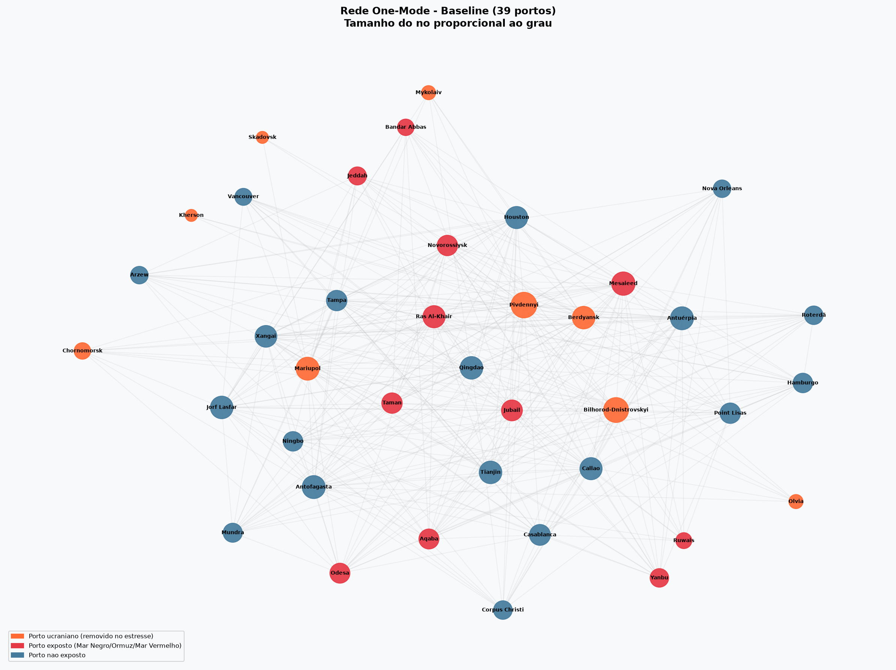

### 02 — Rede One-Mode Cenario de Estresse (30 portos)
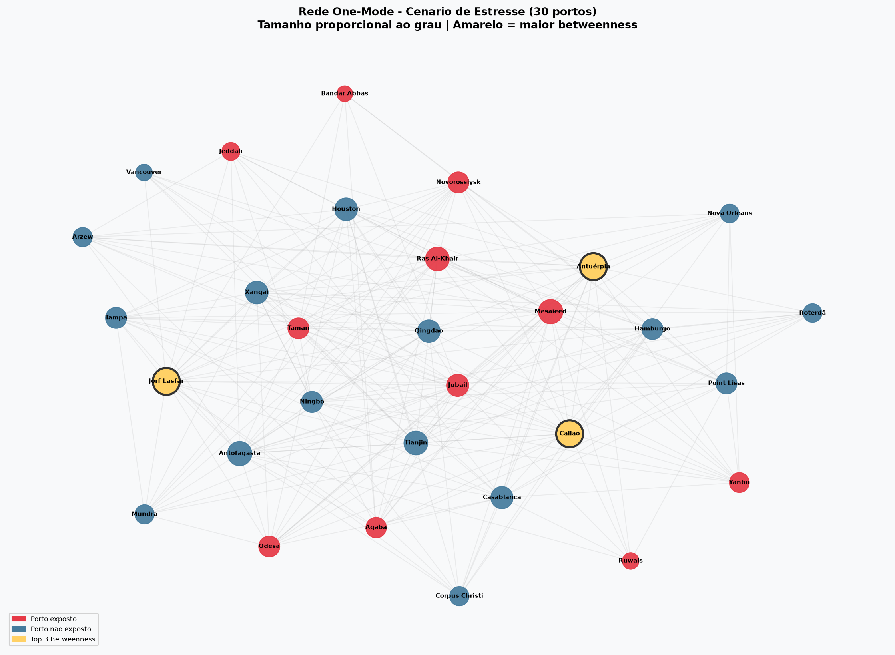

### 03 — Rede Two-Mode Bipartida (30 portos x 21 insumos)
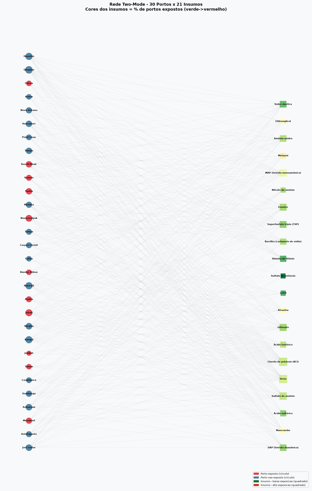

### 04 — Heatmap de Centralidades (Baseline)
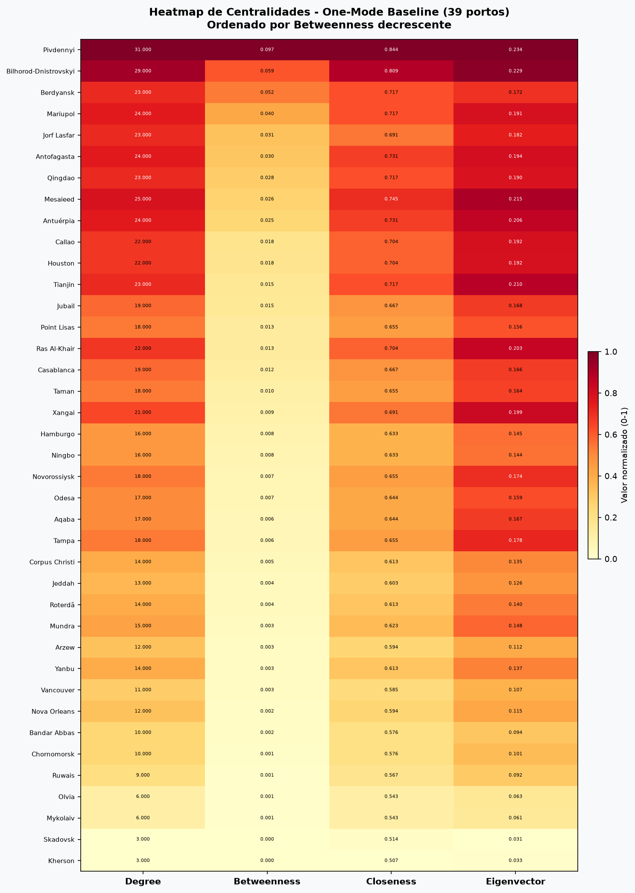

### 05 — Betweenness Centrality
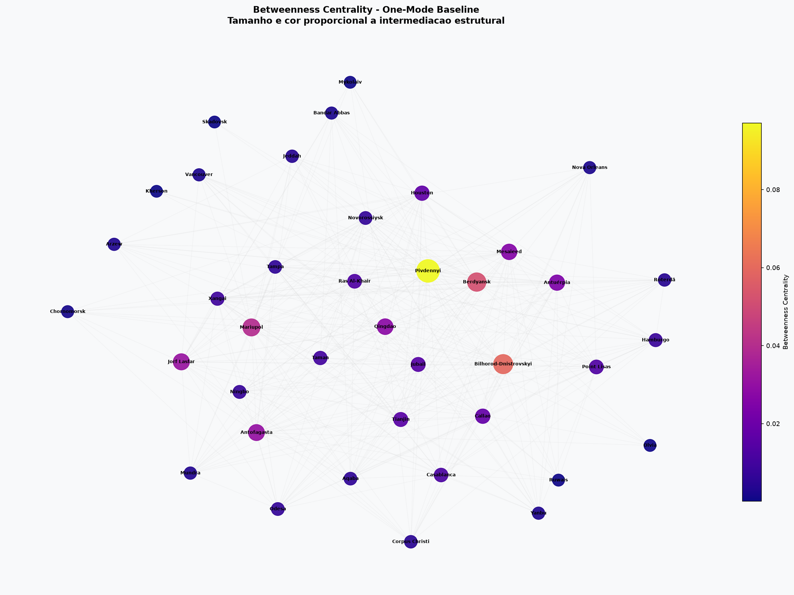

### 06 — Degree: Baseline vs Estresse
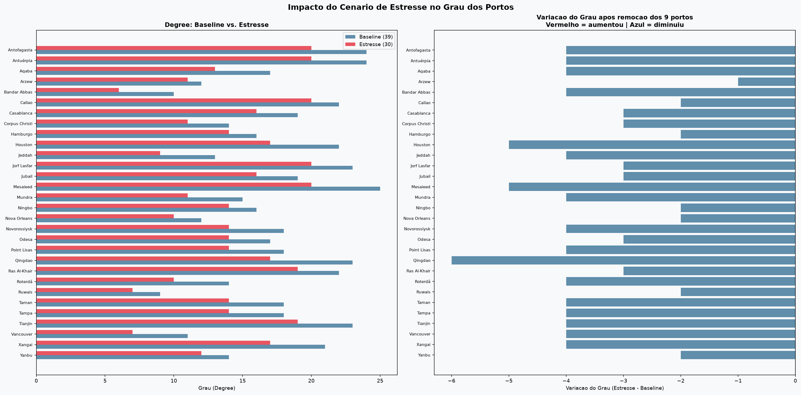

### 07 — Exposicao por Insumo (Two-Mode)
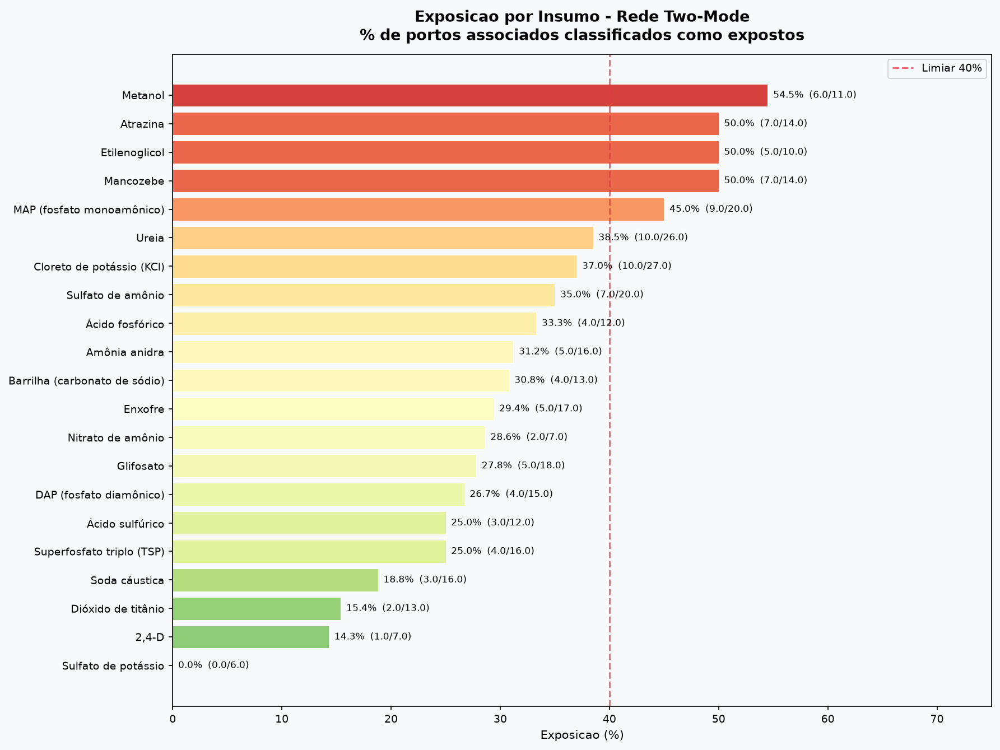

### 08 — K-core Decomposition
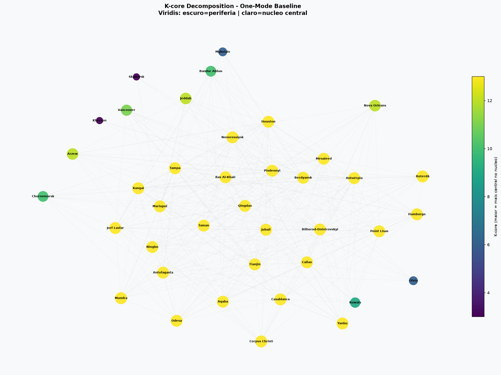

### 09 — Projecao Bipartida: Co-exposicao entre Insumos
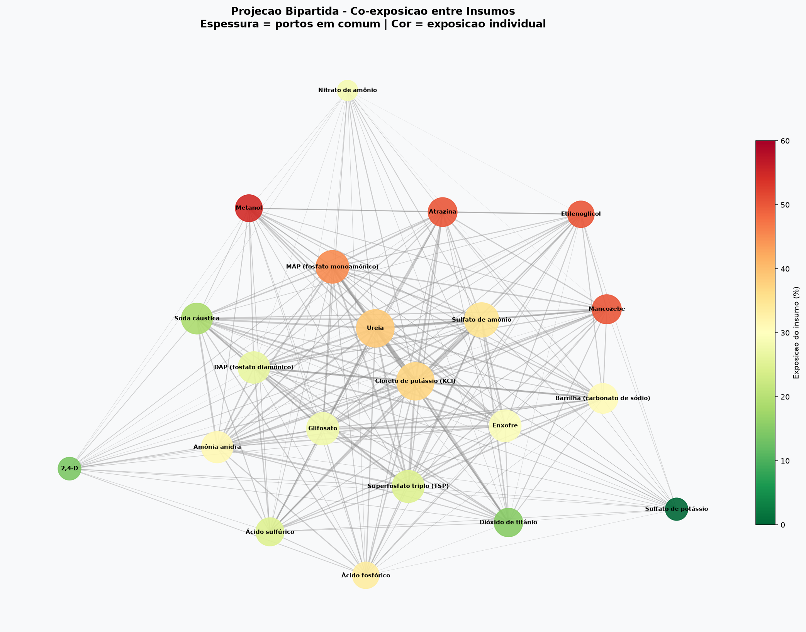

### 10 — Fragmentacao Incremental da Rede
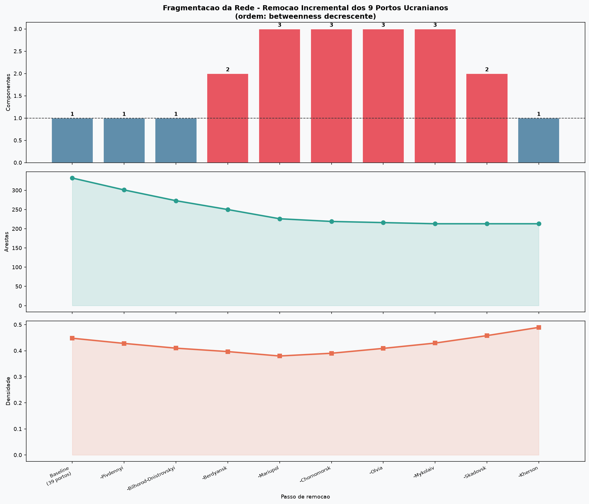

### 11 — Scatter: Grau x Exposicao por Insumo
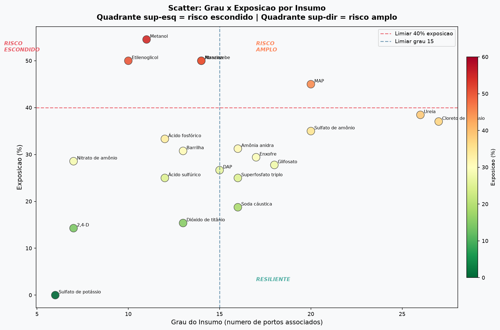

---

## Principais Metricas (One-Mode Baseline)

| Metrica | Valor |
|---------|-------|
| Densidade | 0,448 |
| Diametro | 3 |
| Caminho medio | 1,556 |
| Clustering medio | 0,531 |
| Componentes | 1 |

**Top 5 por Betweenness Centrality:**

| Porto | Betweenness |
|-------|------------|
| Pivdennyi | 0,097 |
| Bilhorod-Dnistrovskyi | 0,059 |
| Berdyansk | 0,052 |
| Mariupol | 0,040 |
| Jorf Lasfar | 0,031 |

---

## Principais Achados (Two-Mode)

| Insumo | Exposicao | Portos |
|--------|-----------|--------|
| Metanol | 54,5% | 6/11 |
| Etilenoglicol | 50,0% | 5/10 |
| Atrazina | 50,0% | 7/14 |
| Mancozebe | 50,0% | 7/14 |
| MAP | 45,0% | 9/20 |
| Ureia | 38,5% | 10/26 |
| KCl | 37,0% | 10/27 |

**Risco estrutural escondido:** Atrazina e Mancozebe possuem apenas 14 portos associados cada, mas 50% estao expostos — maior proporcao entre insumos com grau medio.

**Fragmentacao incremental:** A remocao sequencial gerou ate 3 componentes isolados (apos retirada de Berdyansk e Mariupol), antes da reconexao final com a remocao dos nos perifericos.

---

## Como Reproduzir

```bash
pip install pandas networkx matplotlib openpyxl
python gerar_grafos.py
```

> Os dados de entrada devem estar na pasta `dados/`. Ajuste o caminho `BASE_DATA` no script se necessario.

---

## Disclaimer

Este estudo e uma aplicacao academica e ilustrativa de Analise de Redes Sociais. As matrizes sao binarias e nao incorporam volume transportado, valor comercial, frequencia de embarques ou capacidade portuaria. Os resultados devem ser interpretados como indicadores de vulnerabilidade estrutural do cenario modelado.
